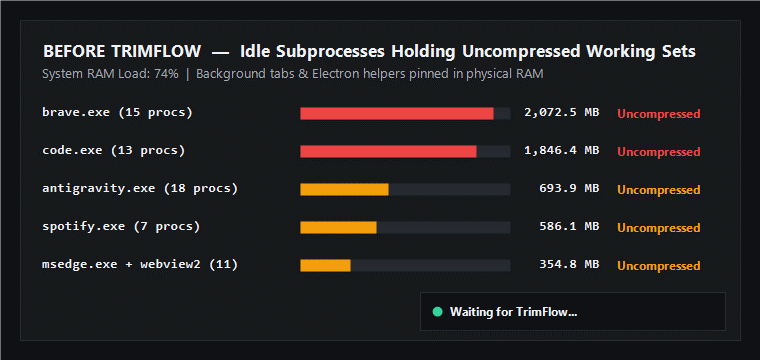

# TrimFlow

**Context-Aware Subprocess Memory & EcoQoS Optimizer for Windows 10/11**

[](https://github.com/vncwr/TrimFlow/actions)
[](LICENSE)
[](#3-real-world-benchmark)
[](https://github.com/vncwr/TrimFlow/releases)

`TrimFlow` is an ultra-lightweight (`~80 KB` Private Working Set, zero external dependencies) native C++17/Win32 system tray and CLI utility that **dynamically discovers** multi-process and memory-heavy desktop applications running in your Windows session—including browsers, Electron/CEF/WebView2 apps, IDEs (`VS Code`, `Cursor`, `Antigravity`), and media clients (`Spotify`, `Discord`)—and reclaims gigabytes of idle physical memory without inducing page-fault stutters in your active window or audio streams.



---

## 1. Install in One Command

### Option A: Scoop (One Command)
```powershell
scoop install https://raw.githubusercontent.com/vncwr/TrimFlow/main/packaging/scoop/trimflow.json
```

### Option B: WinGet (Local Manifest or Community Repository)
```powershell
winget install --manifest packaging\winget\vncwr.TrimFlow.yaml
```

### Option C: Portable Binary (`.exe` / `.zip`)
Download `TrimFlow.exe` (`~70 KB`, single standalone executable, no installer required) from [**GitHub Releases**](https://github.com/vncwr/TrimFlow/releases/latest) and run it directly. Upon launch, TrimFlow displays a non-intrusive status card above the system tray showing live memory reclaimed.

---

## 2. Why TrimFlow Instead of Traditional "RAM Cleaners"?

Modern desktop and web applications rely on multi-process architectures (Chromium's site-isolation model and Electron's helper hierarchy) that spawn 10 to 60+ OS subprocesses per application. Even when background tabs, IDE extension hosts, or covered windows (`code.exe`, `brave.exe`, `Spotify.exe`, `Discord.exe`) are idle, their V8 heaps and uncommitted page tables remain pinned in physical RAM—often consuming **4 GB to 8+ GB**.

Conventional "RAM cleaner" utilities blindly invoke `EmptyWorkingSet` across **every** process on a fixed timer. That causes two severe problems:
1. **UI & Audio Stutters:** Evicting pages from the active foreground window, its `--type=gpu-process` compositor, or `audio.mojom.AudioService` forces immediate hard/soft page faults while you scroll, type, or listen to music.
2. **CPU Page-Table Thrashing:** Repeatedly flushing a dormant background process every 5 seconds burns CPU cycles walking page tables when the process hasn't allocated any new memory.

### How TrimFlow Solves Both

1. **In-Memory PEB Command-Line Role Classification (`NtQueryInformationProcess`)**
   * Inspects remote process command lines to classify every subprocess into `MainOrStandalone` (root UI), `GpuCompositor` (`--type=gpu-process`), `AudioOrNetwork` (`audio.mojom.AudioService`, `network.mojom.NetworkService`), or `RendererOrWorker` (`--type=renderer`, `--type=utility`, `-contentproc`).
   * Audio and network service subprocesses are **unconditionally protected** even when minimized so background music and voice calls never drop a frame.

2. **Foreground Window Protection & `< 1 ms` Focus Promotion (`SetWinEventHook`)**
   * For the **active foreground application**, its main UI host, GPU compositor, and primary active renderer tab remain completely untouched in hot physical RAM.
   * For **covered or minimized applications**, idle background renderers and extension hosts are trimmed once and placed into Windows 11 **Efficiency Mode (`EcoQoS`)** + `BELOW_NORMAL_PRIORITY_CLASS`.
   * Hooks `EVENT_SYSTEM_FOREGROUND` (`WINEVENT_OUTOFCONTEXT`) so the instant you `Alt+Tab` or click into a background app, all of its subprocesses are restored to normal QoS and priority in **under 1 millisecond**.

3. **`+8 MB` Anti-Thrashing Growth Hysteresis**
   * Records each subprocess's post-trim Working Set baseline and skips re-trimming dormant processes until they allocate at least **`+8 MB`** of new pages.

---

## 3. Real-World Benchmark

Measured on a 16 GB Windows 11 workstation running VS Code (`code.exe`), Antigravity IDE, Brave Browser, and Spotify (playing audio in the background):

| Application Group | Subprocesses | Before TrimFlow | After TrimFlow | Physical RAM Reclaimed |
| :--- | :---: | :---: | :---: | :---: |
| **Visual Studio Code (`code.exe`)** *(backgrounded)* | 13 | 1,846.4 MB | 80.0 MB | **-1,766.4 MB (-95.7%)** |
| **Antigravity IDE** | 29 | 1,701.2 MB | 538.9 MB | **-1,162.3 MB (-68.3%)** |
| **Brave Browser (`brave.exe`)** | 16 | 936.9 MB | 200.1 MB | **-736.8 MB (-78.6%)** |
| **Spotify (`Spotify.exe`)** *(audio playing)* | 7 | 228.5 MB | 32.0 MB | **-196.5 MB (-86.0%)** |
| **Total Across Managed Groups** | **65** | **4,713.0 MB** | **851.0 MB** | **-3,862.0 MB (-81.9%)** |

* **System-Wide RAM Load:** Dropped from **79% → 51%** (`~3.86 GB` moved to the Windows Standby List for instant zero-disk soft-fault reuse).
* **`TrimFlow.exe` Own Footprint:** **`0.08 MB` (`80 KB`)** Private Working Set, `0.00%` idle CPU.

---

## 4. Command-Line & Tray Usage

```powershell
TrimFlow.exe            # Launch the system tray optimizer (shows a 4.5s status toast on startup)
TrimFlow.exe --quiet    # Launch silently in the system tray without the startup toast
TrimFlow.exe --once     # Run a single smart optimization pass, print the Before/After table, and exit
TrimFlow.exe --status   # Print current memory usage of discovered process trees without modifying state
TrimFlow.exe --quit     # Gracefully close the running tray instance
```

* **Single-Click Tray Icon:** Summons the live bottom-right status banner showing current memory saved and system RAM percentage.
* **Right-Click Tray Icon:** Opens the custom dark-themed dashboard (`Pause Auto-Trim`, `Run Smart Sweep Now`, `Run at Windows Login`, `Exit TrimFlow`).

---

## 5. Building & Running Tests from Source

Requires [MinGW-w64](https://www.mingw-w64.org/) (`g++` on `PATH`, e.g., via MSYS2 `C:\msys64\ucrt64\bin`):

```powershell
.\test.bat    # Compile and run the 59 unit & benchmark scenario tests (< 2 seconds)
.\build.bat   # Build the standalone ~70 KB TrimFlow.exe binary
```

---

## 6. Safety & Anti-Cheat Compliance

* **Zero Code Injection / Zero Foreign Memory Writes:** TrimFlow uses exclusively documented user-mode Win32 APIs (`SetProcessInformation`, `SetPriorityClass`, `K32EmptyWorkingSet`, and `NtQueryInformationProcess` with `PROCESS_QUERY_LIMITED_INFORMATION`). It never injects DLLs, hooks foreign threads, or modifies foreign virtual memory.
* **Built-In OS & Anti-Cheat Exclusion List:** Automatically excludes critical Windows kernel/session services (`csrss.exe`, `dwm.exe`, `audiodg.exe`, `explorer.exe`), anti-cheat engines (`Vanguard`, `EasyAntiCheat`, `BattlEye`), and active fullscreen games.

---

## 7. Roadmap (`v1.1` Narrow Scope) & Contributing

`v1.1` is intentionally scoped to **diagnostics, observability, and installer polish** without adding bloat:
- [ ] `--diagnose` CLI mode to inspect per-PID command-line role classification and protection reasons
- [ ] `--json` output flag for `--status` and `--once`
- [ ] Optional `trimflow.ini` configuration file & `--validate-config` checker
- [ ] Additional table-driven scenario tests in [`tests/heuristics_test.cpp`](tests/heuristics_test.cpp)

Want to contribute? Read the 2-minute [**Contributing Guide**](CONTRIBUTING.md) and check out our [**`good first issue`**](https://github.com/vncwr/TrimFlow/labels/good%20first%20issue) tickets!

---

## 8. License

Released under the [MIT License](LICENSE).
